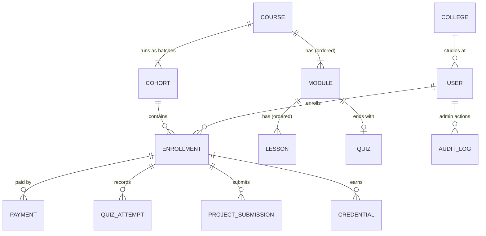

# Data Model — Every Collection, Field and Index

**Status:** ✅ Approved (Oct 16, 2026) — all decisions D1–D9 accepted as recommended, plus D10. Built collections are marked ✅.
**Routes that use these:** [api-routes.md](api-routes.md)

---

## 1. The big picture

In plain words:

- A **Course** is what we sell (e.g. "Full Stack Web Development Internship"). It has **Modules** in order, each with **Lessons** in order and one **Quiz**.
- A **Cohort** is one batch of a course with real start and end dates (e.g. "Nov 2026 batch, Nov 10 – Dec 22"). These dates are printed on the letters.
- A student pays and gets an **Enrollment** in one cohort. The enrollment tracks their progress.
- **QuizAttempts** and **ProjectSubmissions** are the proof of work.
- **Credentials** (offer letter, certificate, completion letter) are issued from the enrollment and can be publicly verified.

## 2. Design rules used everywhere

| Rule | Why |
| --- | --- |
| **Embed** when the data is small, bounded, owned by one parent and read together (profile, quiz questions, enrollment progress, review history) | One read instead of a join |
| **Reference** when the data is large, grows without limit, or is queried on its own (lessons, attempts, payments, credentials) | Documents stay small; independent queries stay fast |
| Child points to parent (`module.courseId`), **parent does not keep a list of children** | One source of truth. The draft `course.modules[]` array is removed — two places storing the same link always drift apart |
| Every query the API makes has an index listed below | No collection scans at 1,000+ users |
| Money is stored in **paise as integers** (`59900` = ₹599) | Floating point can't represent money exactly |
| All dates are UTC `Date`s | Converted to IST only for display / PDFs |
| Values copied at the moment of a business event are **snapshots** (price on a payment, name on a credential) | Later edits never rewrite history |

## 3. Learning content (Phase 1)

### 3.1 `courses`

| Field | Type | Rules / notes |
| --- | --- | --- |
| `title` | string | required, 5–100 |
| `slug` | string | required, unique, `a-z0-9-` — used in URLs (`/courses/full-stack-web-dev`) |
| `tagline` | string | ≤ 160, for cards |
| `description` | string | markdown, ≤ 5,000 |
| `thumbnailUrl` | string? | image URL (R2/CDN) |
| `level` | enum | `beginner` · `intermediate` |
| `skills` | string[] | ≤ 15, shown on certificate page ("React, Node.js, MongoDB") |
| `durationWeeks` | number | 4–12, default length of a cohort |
| `defaultPricePaise` | number | e.g. `59900`; a cohort can override |
| `project` | embedded | the final project brief — see below |
| `status` | enum | `draft` · `published` · `archived` |
| `createdBy` | ObjectId → users | admin |
| `createdAt`, `updatedAt` | Date | timestamps |

`project` (embedded, one per course):

| Field | Type | Notes |
| --- | --- | --- |
| `title` | string | e.g. "Build a job board" |
| `brief` | string | markdown requirements |
| `rubric` | `[{ criterion, maxScore }]` | 3–8 criteria; the mentor scores each |
| `passScorePercent` | number | default 60 |

**Indexes:** `{ slug: 1 }` unique · `{ status: 1, createdAt: -1 }` (public catalog)

### 3.2 `modules`

| Field | Type | Rules / notes |
| --- | --- | --- |
| `courseId` | ObjectId → courses | required |
| `title` | string | 3–100 |
| `description` | string? | ≤ 500 |
| `order` | number | 1, 2, 3 … — drives the unlock sequence |
| `isFreePreview` | boolean | default false. Lessons of a free-preview module are readable without paying (funnel). Quiz still needs enrollment |
| `createdAt`, `updatedAt` | Date | |

No `lessons[]` array (lessons point to their module).

**Indexes:** `{ courseId: 1, order: 1 }` unique — fetch a course's modules in order, and no two modules share a position.

### 3.3 `lessons`

| Field | Type | Rules / notes |
| --- | --- | --- |
| `courseId` | ObjectId → courses | denormalized — lets a course's whole outline load in **one** query |
| `moduleId` | ObjectId → modules | required |
| `title` | string | 3–120 |
| `order` | number | position inside the module |
| `type` | enum | `text` · `video` |
| `content` | string | markdown, ≤ 50,000 chars (notes, code snippets) |
| `videoYoutubeId` | string? | required when `type = video`; embedded, never self-hosted |
| `estimatedMinutes` | number | 1–120, shown in the outline |
| `createdAt`, `updatedAt` | Date | |

The outline query selects only `title, order, type, estimatedMinutes` — `content` is loaded one lesson at a time.

**Indexes:** `{ moduleId: 1, order: 1 }` unique · `{ courseId: 1, moduleId: 1, order: 1 }` (outline in one query)

### 3.4 `quizzes`

One per module.

| Field | Type | Rules / notes |
| --- | --- | --- |
| `courseId`, `moduleId` | ObjectId | |
| `passPercent` | number | default 60 |
| `questions` | embedded array | 3–30 per quiz — see below |
| `updatedAt` | Date | |

`questions[]`:

| Field | Type | Notes |
| --- | --- | --- |
| `_id` | ObjectId | stable ID so answers map to questions even if order is shuffled |
| `prompt` | string | markdown (code allowed) |
| `type` | enum | `single` (one right option) · `multiple` (all right options must be picked) |
| `options` | string[] | 2–6 |
| `correctOptionIndexes` | number[] | **never sent to the student** — removed by the service before responding |
| `explanation` | string? | shown after an attempt is graded |
| `points` | number | default 1 |

**Indexes:** `{ moduleId: 1 }` unique

## 4. Batches, enrollment and progress (Phase 1)

### 4.1 `cohorts`

| Field | Type | Rules / notes |
| --- | --- | --- |
| `courseId` | ObjectId → courses | |
| `name` | string | e.g. "November 2026" |
| `code` | string | unique, short, e.g. `FSWD-NOV26` (appears on letters) |
| `startDate`, `endDate` | Date | the real internship dates printed on documents |
| `enrollOpensAt`, `enrollClosesAt` | Date | enrollment window |
| `capacity` | number | max seats (mentor review capacity) |
| `seatsTaken` | number | incremented atomically on payment — never counted live |
| `pricePaise` | number | snapshot of price for this batch (early-bird batches possible) |
| `status` | enum | `scheduled` · `open` · `running` · `completed` · `cancelled` |
| `communityLink` | string? | WhatsApp/Discord invite, shown only to paid students |

**Seat safety:** a seat is claimed with one atomic update — `updateOne({ _id, seatsTaken: { $lt: capacity } }, { $inc: { seatsTaken: 1 } })`. If 50 students pay for the last seat at the same second, exactly one update succeeds. The others are refunded automatically (Phase 3).

**Indexes:** `{ code: 1 }` unique · `{ courseId: 1, status: 1, startDate: 1 }` (open batches for a course)

### 4.2 `enrollments`

The center of the system: everything a student does in a cohort hangs off this document.

| Field | Type | Rules / notes |
| --- | --- | --- |
| `userId` | ObjectId → users | |
| `courseId` | ObjectId → courses | denormalized for "my courses" without a join |
| `cohortId` | ObjectId → cohorts | |
| `status` | enum | `pending_payment` · `active` · `completed` · `cancelled` · `refunded` |
| `progress` | embedded array | one entry per module — see below |
| `projectStatus` | enum | `not_submitted` · `pending_review` · `changes_requested` · `approved` |
| `completedAt` | Date? | when every requirement was met |
| `activatedAt` | Date? | when payment was confirmed |
| `createdAt`, `updatedAt` | Date | |

`progress[]` (bounded: ~10 modules per course, so embedding is safe):

| Field | Type | Notes |
| --- | --- | --- |
| `moduleId` | ObjectId | |
| `completedLessonIds` | ObjectId[] | added with `$addToSet` (marking twice does nothing) |
| `quizPassed` | boolean | |
| `bestQuizScorePercent` | number | |
| `completedAt` | Date? | all lessons done + quiz passed (a module without a quiz completes when its lessons are done) |

**Unlock rule (sequential):** module *N* opens only when module *N − 1* has `completedAt`. The unlocked state is **computed** from `progress` on each request, not stored — a stored "current module" field could drift from the real progress. Checked on the server for every lesson and quiz request — the frontend lock icon is just a display.

**Indexes:** `{ userId: 1, cohortId: 1 }` unique (no double enrollment in one batch) · `{ userId: 1, status: 1 }` (my enrollments) · `{ cohortId: 1, status: 1 }` (admin: students in a batch) · `{ status: 1, projectStatus: 1, updatedAt: 1 }` (review queue)

### 4.3 `quizattempts`

| Field | Type | Notes |
| --- | --- | --- |
| `enrollmentId`, `userId`, `quizId`, `moduleId` | ObjectId | |
| `answers` | `[{ questionId, selectedOptionIndexes }]` | |
| `scorePercent` | number | graded **on the server** |
| `passed` | boolean | |
| `attemptNumber` | number | 1, 2, 3 … |
| `createdAt` | Date | |

Separate collection because attempts grow without a fixed limit and are only read in a list ("your attempts").

**Indexes:** `{ enrollmentId: 1, moduleId: 1, createdAt: -1 }`

### 4.4 `projectsubmissions`

| Field | Type | Notes |
| --- | --- | --- |
| `enrollmentId`, `userId`, `courseId`, `cohortId` | ObjectId | |
| `version` | number | 1, 2 … (resubmissions after "changes requested") |
| `repoUrl` | string | must be `https://github.com/...` |
| `liveUrl` | string? | `https://` only |
| `notes` | string? | ≤ 2,000 |
| `status` | enum | `pending` · `approved` · `changes_requested` |
| `review` | embedded? | `{ reviewerId, rubricScores: [{ criterion, score }], totalPercent, feedback, decidedAt }` |
| `createdAt` | Date | |

**Indexes:** `{ enrollmentId: 1, version: -1 }` · `{ status: 1, createdAt: 1 }` (review queue, oldest first)

## 5. Money (Phase 3)

### 5.1 `payments`

| Field | Type | Notes |
| --- | --- | --- |
| `userId`, `enrollmentId`, `cohortId` | ObjectId | |
| `amountPaise` | number | **snapshot** of the cohort price when the order was created |
| `currency` | string | `INR` |
| `razorpayOrderId` | string | unique — created before checkout |
| `razorpayPaymentId` | string? | unique (sparse) — set when paid |
| `status` | enum | `created` · `paid` · `failed` · `refunded` |
| `method` | string? | `upi` · `card` · `netbanking` … (from Razorpay) |
| `processedEventIds` | string[] | Razorpay webhook event IDs already handled → a repeated webhook is ignored |
| `paidAt`, `refundedAt` | Date? | |
| `createdAt`, `updatedAt` | Date | |

**Idempotency:** marking a payment paid is `updateOne({ razorpayOrderId, status: 'created' }, …)`. Whether the checkout callback or the webhook arrives first, or the webhook arrives five times, only the first one changes anything. Activating the enrollment and claiming the seat happen in the **same MongoDB transaction** as marking the payment paid.

**Indexes:** `{ razorpayOrderId: 1 }` unique · `{ razorpayPaymentId: 1 }` unique sparse · `{ userId: 1, createdAt: -1 }` · `{ status: 1, createdAt: -1 }` (admin)

## 6. Trust (Phase 3)

### 6.1 `credentials`

Offer letters, certificates and completion letters — the product the business sells.

| Field | Type | Notes |
| --- | --- | --- |
| `credentialId` | string | **public** ID, unique, e.g. `BYD-26-7KQ4-M9XA` (random, not guessable, no confusable characters like 0/O) — printed on the PDF and in the QR code |
| `type` | enum | `offer_letter` · `completion_certificate` · `completion_letter` |
| `userId`, `enrollmentId`, `courseId`, `cohortId` | ObjectId | |
| `snapshot` | embedded | `{ studentName, collegeName, courseTitle, skills, cohortName, cohortCode, startDate, endDate, durationWeeks, issuedAt, issuer: { legalName, registrationNo, address, email, signatoryName, signatoryTitle, brand, programName } }` — copied at issue time, **never edited** |
| `pdfKey` | string? | object key in Cloudflare R2; set by the worker when the PDF is ready |
| `status` | enum | `generating` · `issued` · `revoked` |
| `revokedAt`, `revokedReason`, `revokedBy` | ? | only revocation can change a credential |
| `createdAt` | Date | |

**Immutable by code:** the model blocks any update that touches `snapshot`, `type`, `credentialId` or the IDs. Only `status`, `pdfKey` and the revocation fields can change.
**No duplicates:** unique `{ enrollmentId, type }` — if the PDF job runs twice, the second insert fails harmlessly.
**Name lock:** issuing the first credential sets `user.profile.certificateNameLockedAt` (already built in Phase 0).

**Indexes:** `{ credentialId: 1 }` unique (public verify) · `{ enrollmentId: 1, type: 1 }` unique · `{ userId: 1, createdAt: -1 }` (my documents)

### 6.2 `auditlogs` ✅

Every admin action that affects trust or money: revoke, review decision, refund, price change, manual issue.

| Field | Type | Notes |
| --- | --- | --- |
| `actorId` | ObjectId → users | the admin/mentor |
| `action` | string | e.g. `credential.revoke`, `submission.review`, `cohort.update_price` |
| `targetType`, `targetId` | string, ObjectId | what was changed |
| `details` | object | before/after values, reason |
| `createdAt` | Date | |

Append-only (no update/delete routes). **Indexes:** `{ targetType: 1, targetId: 1, createdAt: -1 }` · `{ actorId: 1, createdAt: -1 }`

## 7. Already built ✅

| Collection | Built in | Notes |
| --- | --- | --- |
| `users` | Phase 0 | Auth fields + embedded `profile` + `onboardingCompleted`. **Change proposed:** `role` enum becomes `student` · `mentor` · `admin` (mentors can review projects, nothing else) — see decision D6 |
| `colleges` | Phase 0 | Student-built list for autocomplete |

## 8. Redis keys (complete list)

| Key | Holds | TTL | Phase |
| --- | --- | --- | --- |
| `otp:<purpose>:<email>` | OTP hash + attempts | 10 min | 0 ✅ |
| `otp_cooldown:<purpose>:<email>` | resend cooldown | 60 s | 0 ✅ |
| `session:<sid>`, `user_sessions:<userId>` | refresh sessions | 7 d | 0 ✅ |
| `rl:<limiter>:<key>` | rate-limit counters | window | 0 ✅ |
| `colleges:search:<q>` | autocomplete results | 5 min | 0 ✅ |
| `cache:courses:published` | public catalog list | 10 min, deleted on admin edit | 1 |
| `cache:course:<slug>:outline` | modules + lesson titles | 10 min, deleted on admin edit | 1 |
| `cache:lesson:<id>` | lesson content | 30 min, deleted on admin edit | 1 |
| `cache:verify:<credentialId>` | public verify result | 10 min, deleted on revoke | 3 |
| `bull:*` | BullMQ job queues (`documents`, `emails`) | managed by BullMQ | 3 |

Cache rule: **read-through with TTL + delete on write.** Content changes rarely and is read constantly; per-student progress is never cached.

## 9. Decisions (approved Oct 16, 2026)

| # | Decision | Recommendation | Why |
| --- | --- | --- | --- |
| D1 | **Naming:** what the code calls the product | `Course` in code and admin; "Internship Program" on the website and letters | One simple word for us; the marketing name can change any time |
| D2 | **When the certificate is issued** | Only **after the cohort end date** (and all work approved). Students who finish early see "Eligible — issued on Dec 22" | The dates on the certificate must be real. An "8-week internship" finished in 3 days and certified immediately is what makes colleges stop trusting a provider |
| D3 | **Quiz rules** | Pass at 60%; unlimited attempts; 1-minute wait between attempts; question order shuffled; best score kept | Learning-friendly but not brute-forceable |
| D4 | **Lesson completion** | Student taps "Mark as complete" (no read-time tracking) | Simple and good enough; the quiz and project are the real proof of work |
| D5 | **Price lives on the cohort** (course has a default) | Yes | Allows early-bird or festival pricing per batch without touching old payments |
| D6 | **Add a `mentor` role now** | Yes — can only see the review queue and review projects | Review time is the scaling bottleneck; you'll want helpers without giving them admin |
| D7 | **Refunds** | Manual in Razorpay dashboard; admin marks the enrollment refunded in our panel → its credentials are revoked. Policy wording (e.g. "within 7 days, before any certificate") goes on the Refund page | Automating refunds isn't worth it for launch volume |
| D8 | **Free preview** | Module 1 lessons of every course are readable without paying (no quiz) | Lets students judge quality before paying — the funnel in [business-model.md](../business-model.md) |
| D9 | **Grade on the certificate** | Not at launch — "Completed" only. Add grades later from quiz + rubric scores (already stored) | Fewer things to get wrong before Diwali; the data is kept, so grades can be added without migration |
| D10 | **When paid content opens** | On the cohort's `startDate` (free-preview modules are always open) | Same principle as D2 — the internship really runs between the printed dates. One check in `enrollment.service`, easy to change |

## 10. Size at 1,000 students (why MongoDB is comfortable)

| Collection | Documents | Notes |
| --- | --- | --- |
| users | ~1,500 | incl. unpaid signups |
| enrollments | ~1,000 | each < 5 KB |
| quizattempts | ~25,000 | 10 modules × ~2.5 attempts |
| projectsubmissions | ~1,500 | |
| payments | ~1,200 | |
| credentials | ~3,000 | 3 per completed student |
| lessons | ~200 | content cached in Redis |

All of this is a few hundred MB at most — every collection fits in memory on a small Atlas tier. The design limit is not storage; it's query patterns, which is why every list above has an index.
